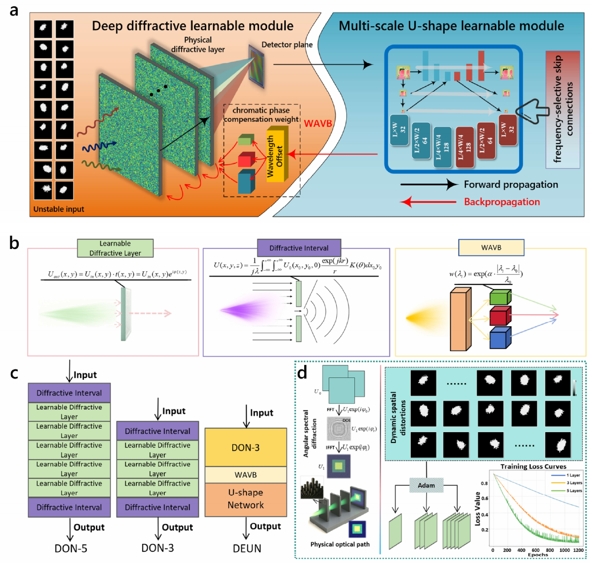
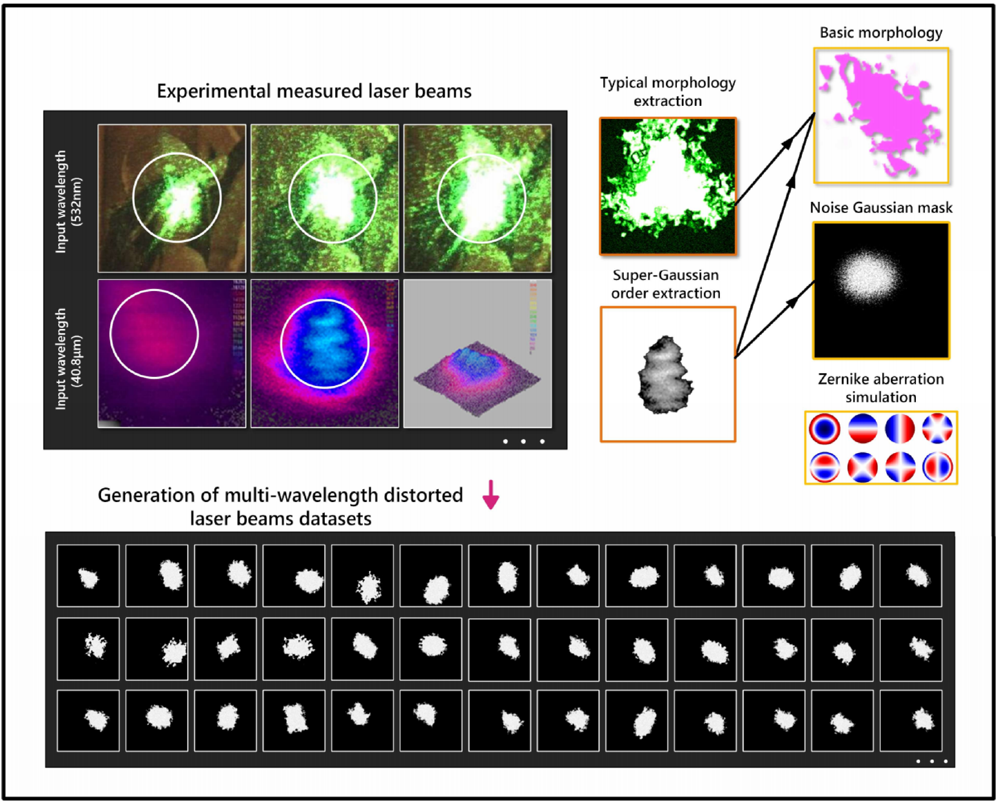
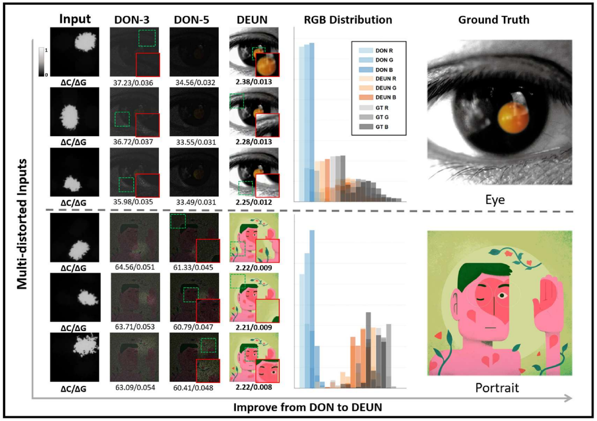

# DEUN-LightShaper

**Real-time color light field shaping with a diffractive-electronic U-shape network.**

Official project repository for **[Color-resolved light field shaping via diffractive-electronic U-shape network with wavelength-aware virtual branching](https://doi.org/10.1016/j.neunet.2025.108502)**.

Yuheng Zong, Huaiping Jin, Hao Fang, Chai Hu, and Jiashuo Shi

**Accepted by Neural Networks on December 15, 2025.** Published online December 22, 2025; *Neural Networks*, **197** (May 2026), 108502.

**The model and dataset have been open-sourced and are available in the supplementary materials accompanying the published paper.**

## Overview

DEUN reshapes dynamically distorted Gaussian beams into stable, color-resolved target patterns. A three-layer diffractive optical front-end works with an electronic U-shape decoder to combine optical wavefront modulation with nonlinear residual correction.

- **Wavelength-aware virtual branching (WAVB):** wavelength-conditioned training improves chromatic compensation through a shared diffractive structure, without adding physical branches.
- **Frequency-selective skip connections (FSSC):** learned frequency masks restore mid- and high-frequency details while limiting low-frequency overcompensation.
- **Diffractive optical flow prediction:** models frame-to-frame beam evolution to support temporal coherence and predictive correction.



*Figure 1. Hybrid architecture and training workflow.*

## Dataset

The hybrid experimental-synthetic dataset combines measured beam morphology and super-Gaussian profiles with simulated aberrations and noise. The paper uses 50 visible-light profiles at 532 nm and 12 terahertz profiles at 40.8 micrometers to inform synthesis, and evaluates dynamic shaping on 500 frames at 256 x 256 pixels.



*Figure 2. Measured beam characteristics guide distorted-beam synthesis.*

## Results

DEUN improves color fidelity, detail recovery, and noise suppression compared with DON-3 and DON-5 in the reported experiments.



*Figure 3. Reconstruction examples under dynamic input distortions.*

| Configuration | PSNR (dB) | SSIM | Latency (ms/frame) |
| :--- | ---: | ---: | ---: |
| Without WAVB | 20.13 | 0.871 | 17.6 |
| Without FSSC | 21.93 | 0.866 | 17.9 |
| **Full DEUN** | **22.61** | **0.874** | **18.1** |

Values are reported in Table 1 of the paper. The reported 18.1 ms/frame latency supports operation above 50 Hz; timing was measured on an RTX 5090 workstation and averaged over 500 sequential frames. Evaluation includes numerical diffraction and tests with experimentally measured beam inputs.

## Citation

If you use this work, please cite:

```bibtex
@article{zong2026deun,
  title   = {Color-resolved light field shaping via diffractive-electronic
             {U}-shape network with wavelength-aware virtual branching},
  author  = {Zong, Yuheng and Jin, Huaiping and Fang, Hao and
             Hu, Chai and Shi, Jiashuo},
  journal = {Neural Networks},
  volume  = {197},
  pages   = {108502},
  year    = {2026},
  doi     = {10.1016/j.neunet.2025.108502}
}
```

Figures are reproduced from Figures 1-3 of the paper; panel content is unchanged.
